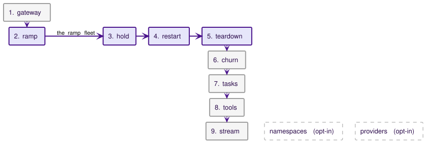

# Performance and scale

This page states the performance harness, the environment it runs on, the baseline it produced, and the Secret watcher benchmark that runs beside it. The numbers are a baseline, not a pass mark: a release runs the same harness on the same environment and compares against it, and the page states what a real cluster changes.

## What the harness measures

`make perf` creates a dedicated k3d cluster and installs the chart with the mock provider trusted for upstream and callbacks and the pprof listeners open; the console and tracing stay off. The harness (`test/perf`) then applies `test/perf/testdata/infra.yaml` and runs the default nine phases in order. Two more phases run only when `-phases` names them. Each phase writes its own block of the summary JSON. The ramp leaves its fleet up for the hold, restart, and teardown phases; every other phase cleans up its own objects.

The infrastructure file holds the `perf` namespace, the mock provider, two mock MCP servers, one per MCP protocol era, behind the ToolProviders `perf-mcp` (2026-07-28) and `perf-mcp-legacy` (the legacy session era), and six ModelProviders. The gateway legs select four of them: `perf-fast`, `perf-slow`, `perf-hard`, and `perf-limited`. The streaming phase adds two: `perf-anthropic`, of the Anthropic type, so its leg is relayed natively and not translated, and `perf-paced`, whose mock waits 10 ms between streamed events.




The default run drives non-streaming chat completions through the agent fleet and the gateway legs, in one namespace. The tools and stream phases add tool calls and streamed answers at the gateway. The two opt-in phases spread the fleet over many namespaces and the control plane over many providers and classes. `perf-limited` is `perf-fast` with `rateLimits.requestsPerMinute` and `tokensPerMinute` both set to 2000000000, far above any rate a leg reaches, so every request on it runs the gateway's rate limiter and none is refused.

1. **Gateway steady state.** An in-cluster load generator calls the LLM proxy at fixed concurrency in five legs: the ServiceAccount-token tier against a mock provider that answers immediately, then the mTLS path (the load generator presents the certificate of a real Agent) against an immediate provider, a 50 ms provider, an immediate provider under hard budget enforcement, and an immediate provider with rate limits on. Each leg records client-observed latency, the gateway's own request histogram, the gateway's peak CPU and memory, and the gateway's CPU per request: the gateway's process CPU over the leg, summed across replicas, divided by the requests the gateway counted. The immediate legs isolate the gateway's per-request cost; the hard leg isolates what synchronous ledger admission adds, and the rate-limits leg isolates what the request and token limiter adds.
2. **Max-active ramp.** Agents are created in waves of 50, with persistence and hibernation off, and none are retired. The ramp stops at the target or at the environment's first limit: agent Pods crash-looping on probe timeouts, host memory below a floor, a node reporting memory pressure, the scheduler refusing a Pod, or a wave that misses Ready within `-wave-timeout` (default six minutes). The wave that hits the limit is trimmed, so the later phases run on the largest fleet that came up clean. Each wave records time-to-Ready (creation to the Ready condition) and its breakdown (certificate issuance, Pod start, start to Ready), the controller's reconcile histogram and queue depth, the operator components' memory, and the host's available memory, which yields the memory cost per running agent.
3. **Hold and serve.** At the peak fleet, every active agent receives one message per interval through its own async webhook channel, with replies pushed to the mock's callback receiver. The phase records accepted messages, every delivery attempt by outcome, callback counts, message latency, and whether any agent lost readiness or restarted. Around the hold it reads what the operator asked of the apiserver, and from that the writes per agent per minute. During the hold it samples goroutines, heap, and RSS from both components once a minute, so a long hold (`-hold-duration 60m`) is the soak.
4. **Restart under load.** With the fleet up, a rolling restart of the controller (rollout time, then time to the first reconcile of the new leader), then a rolling restart of the gateway under a 60 s token-tier LLM leg, counting the requests that fail while it rolls, then a controller leader failover. The phase also measures what the channels' Secrets cost a process that restarts, in three parts:

   - **Gateway sweeps.** The harness posts one message to each channel slot that every Ready agent in the run lists, against each gateway replica on its own, retrying a channel every second until the replica accepts it or five minutes pass. One sweep runs before the rollouts (the warm control) and one after the gateway rollout (cold). The gateway loads a channel's Secrets on first use, so only traffic shows how long a restarted replica takes to serve them. The run adds a note when the listed channel count differs from the Ready agents times `-channels-per-agent`, and when the sweeps leave some listed channels out because not every Ready agent lists their slot.
   - **Controller warm-up.** The time from the start of the controller rollout until the new leader has reconciled every channel and the channel queue is empty. Each channel pass reads its Secrets through the controller's rate-limited client, so a cold process takes longer than a warm one.
   - **Leader failover.** The harness deletes the leader's Pod with no grace period, but the kubelet still sends SIGTERM and the manager releases its Lease on shutdown, so the standby most likely takes over at its next retry, as in a rollout ([Restart under load](#restart-under-load)). The harness follows the Lease from the delete and records which happened in `failover.lease`. Failover times the first reconcile, the channel warm-up, and the Deployment's return to Ready, each from the delete. The warm-up is the figure to read: the new leader starts its Secret informers cold, whichever way the Lease changed hands.

   The harness reads figures at four points: before the rollouts, after the controller rollout and its warm-up, after the gateway rollout and its sweep, and after the failover. It waits 30 s after the sweep so the callbacks of the sweep's replies have loaded the HMAC Secrets. Each gateway and controller process reports its goroutines, heap in use, RSS, API GETs since it started, and open watch streams. The GET counter starts at zero in a new process, so after a restart it counts what the cold start asked of the API server. The harness counts a process's watch streams in its goroutine profile, which it reads through the pprof listener, so keep `PERF_PPROF_PORT` non-zero ([Run the harness](#run-the-harness)). With the listener off, the other figures stay and the watch counts are left out.

   The API server reports its RSS, CPU seconds, and open Secret watches, read from `apiserver_longrunning_requests{verb="WATCH",resource="secrets"}`. That count covers every client on the cluster, and kubelets hold one watch per mounted Secret, so compare the count between points, not as an absolute value. The k3s server process hosts every control-plane component, so its RSS and CPU are the whole control plane's.
5. **Fleet teardown.** Deleting the whole ramp fleet and timing until its Pods are gone.
6. **Hibernation churn.** A persistence-enabled subset with short idle timers. The harness waits for every agent's first hibernation and then for every churn channel's `PlatformConnected` condition to read `NoRecentTraffic`. A channel with no traffic flips to that reason once a gateway replica has been up for its health window (`--channel-health-window`, default 5 minutes), one controller status write per channel, so the wait keeps those writes out of the idle figure. The wait is bounded at 7 minutes, fails the phase past that, and is recorded as `churn.idleSettleSec`. The harness reads the same control-plane counters over an idle window with the whole subset hibernated, then sends each agent one message per cycle, with the cycle longer than a hibernation cycle so every message is a cold wake. It reads the control-plane counters again over the active window, from the first message to the end of a 90 s settle after the last. It records the wake latency distribution from the gateway's wake histogram, wakes and hibernations from the controller's counters, and delivery outcomes.
7. **Concurrent tasks.** Submitting the task batch at once (`KAALM_TASK_AUTOCOMPLETE=success` makes each task report success on startup) and recording provisioning latency, run time, makespan, throughput, and retries. It reads the control-plane counters over the batch, from submission until every task settles or the task timeout expires, so the window shows per-task status writes that a fleet hold cannot. The window has tasks and no agents, so it prints requests per second per component and the largest apiserver rows, with no per-agent write rates. A task starts only after its Certificate is Ready, so the baseline raises cert-manager's API client limit to keep the batch from measuring cert-manager ([cert-manager's API client limit](https://github.com/win07xp/kaalm/blob/main/guide/src/platform/tuning.md#cert-managers-api-client-limit)).
8. **Tool plane** (about 3.5 minutes). Three legs call `tools/call` through the broker. The token tier and mTLS legs use `POST /v1/mcp/perf-mcp` on the 2026-07-28 MCP revision. The third leg is mTLS through `POST /v1/mcp/perf-mcp-legacy` in the legacy session era: each caller opens its session once before measuring, then every `tools/call` carries the wrapped session id, which the broker checks on every call ([Session ownership](../gateways/tool-plane.md#session-ownership-legacy-revisions)). Comparing this leg with the mTLS 2026-07-28 leg shows what legacy session checking costs per call. It runs over mTLS only because legacy clients run in Kaalm-managed agents, and the first two legs already show the token-versus-mTLS cost. The mock tool servers answer only with the credential the gateway injects, so a successful call proves the injection. Each leg records client latency by auth mode, the broker's histogram (forwarded calls only), calls by status, and CPU per request. The broker figures count `tools/call` of the leg's tool only. They leave out the per-caller handshake requests and any denial the broker makes before it reads the request (namespace, grant, class, rate limit), which show only in the client's statuses. They include the warmup's one successful call, which the client's figures leave out. Each brokered call also writes the gateway's audit log line, which is part of the measured cost. The client's `statuses` map counts a 200 that carries a JSON-RPC error under `rpc_error`, not `200`.
9. **Streaming** (about 3.5 minutes). Three token-tier legs at the gateway concurrency read each stream to its end: OpenAI with an immediate mock, Anthropic with an immediate mock, and OpenAI against `perf-paced`. Each leg records time to first byte, time to last byte, requests per second, spend and missing-usage counts (the proof that usage accounting survives the stream), CPU per request, and peak gateway memory. The client's `statuses` map counts a 200 whose stream ends before `[DONE]` (OpenAI) or `message_stop` (Anthropic) under `incomplete`, not `200`.

   The immediate mock writes a whole stream at once, so on those legs time to first byte mostly measures gateway overhead. The paced mock sends the first event at once and waits 10 ms before each later one. An OpenAI stream with usage has five writes, so on that leg time to last byte sits about 40 ms above time to first byte by construction. A gap near 40 ms shows the gateway relays each event as it arrives. A gateway that buffered the stream would send the first byte only when the last event arrived, so the gap would shrink toward zero.

Two more phases run only when `-phases` names them, because each takes long enough that the default run should not grow by it unasked:

- **Many namespaces** (`-phases namespaces`, 6 minutes 53 seconds). The ramp, hold, and teardown on 400 agents spread over 20 namespaces (`-namespaces-agents` and `-namespaces-count`). It reports the same figures as those phases, so they compare with the one-namespace rows. The namespaces are `perf-00` to `perf-19`, named after `-namespace`. Each carries the label `perf.kaalm.io/phase=namespaces` and gets copies of the `perf-hook` and `perf-callback-hmac` Secrets. The phase deletes the namespaces when it ends, on failure too. It refuses to run while the ramp fleet is up, because both fleets together pass the machine's pod ceiling.
- **Many providers and classes** (`-phases providers`, 5 minutes 41 seconds). 50 ModelProviders and 50 AgentClasses (`-providers-count`), each class allowing every provider. Both sets are named `perf-many-00` to `perf-many-49`. The phase records time to Ready, the `modelprovider` and `agentclass` reconcile counts and latency, a steady control-plane audit over `-idle-duration`, and the first two gateway legs (token tier and mTLS, immediate upstream), which compare with the [gateway table](#gateway). The peak controller and gateway usage it reports covers the whole setup, from creating the providers until every class is Ready, plus the audit window, so it is not a reading taken after setup.

Timings that come from API objects (time-to-Ready, task completion) have one-second granularity, so the distributions come from the Prometheus histograms and the objects supply the coarse per-agent numbers. Client-side percentiles are exact, from every sample the load generator recorded; gateway-side and delivery percentiles are interpolated from histogram bucket bounds, so they can sit above the client figure for the same leg, and a value at the top finite bucket reads as that bucket's bound.

The gateway-side figures of a gateway, tools, or stream leg come from scraping every gateway replica's `/metrics` before and after the leg and subtracting. The scrape skips a terminating Pod, which stays Running for a few seconds while the gateway drains. When the two scrapes cover different gateway Pods, counters from different Pods do not subtract, so the leg leaves its gateway-side figures out (latency, request count, CPU per request, spend, budget utilization, missing usage, and the tools leg's calls by status), sets `gatewayPodsChanged: true` in its JSON, and prints a note under its summary line. The client-side figures stay. A ramp wave or the providers setup leaves out its controller reconcile figures the same way and logs a line.

### Restart result fields

The `restart` block keeps its rollout fields (`controllerRolloutSec`, `controllerFirstReconcileSec`, `gatewayRolloutSec`, `gatewayClient`, and `gatewayFailed`), so a result still compares with the baseline files on them. The Secret measurements add these fields:

- `channels` and `channelSecrets`: the fleet's listed channels and the number of distinct Secrets that their bearer and callback HMAC refs name, counted once per namespace. For a fleet ramped in the same run, this is 2 with the shared pair and `2*min(N, channels)` with `-channel-secrets N`. A restart run on an existing fleet reports what the fleet holds (its channels, their Secrets, and the slots it sweeps), whatever `-channel-secrets` and `-channels-per-agent` the run was given.
- `controllerWarmupSec`: the seconds from the start of the controller rollout until the new leader has reconciled every channel with an empty queue. A value of 0 means the warm-up was not reached in 10 minutes, not an instant one. The summary's `notes` then give the last reconcile count and queue depth.
- `controllerWarmupWatches`: the API server's open Secret watches, sampled every 2 s during the warm-up as `atSec` and `secretWatches`. It shows the watches opening as the new leader loads its Secrets.
- `sweepBefore` and `sweepAfter`: one entry per gateway replica, answering how long that replica takes to serve every channel. Each holds `target` (the replica's Pod name), `channels`, `served`, `unserved` (never accepted within five minutes), `requests`, `servedSec` (the time of the last acceptance), `acceptMs` (each channel's time to acceptance, with `p50`, `p95`, and `max`), `statuses`, and `errors`. Compare `sweepAfter` with `sweepBefore`, the warm control.
- `failover`: `killed`, `newLeader`, `lease`, `firstReconcileSec`, `warmupSec`, and `recoveredSec` (the Deployment Ready again), each timed from the delete, plus `watches`, the same series as `controllerWarmupWatches` from the delete. `lease` is `released` when the killed holder cleared the Lease, `expired` when the standby took it only after the last renewal's lease duration ran out, and an empty string when the harness could not read the Lease to tell (a note says why). `failover` is `null` when the Lease has no holder or the holder's Pod is already gone.
- `figures`: keyed by point (`before`, `afterControllerRollout`, `afterGatewayRollout`, `afterFailover`). Each point holds a `gateway` and a `controller` list with one entry per Pod (`pod`, `leader` on the controller leader, `goroutines`, `heapMiB`, `rssMiB`, `apiGets`, `watches`) and an `apiserver` object (`rssMiB`, `cpuSeconds`, `secretWatches`). `cpuSeconds` is the process total, so subtract between points. `afterFailover` is absent when `failover` is `null`.

The sweeps and the figures never fail the phase. A sweep or a figures read that fails becomes a note, and its field is left out. A Pod whose goroutine profile cannot be read keeps its other figures and loses `watches`. A controller that does not reconcile within five minutes of the leader delete fails the phase.

The summary's `config` block records `ChannelSecrets`, `ChannelsPerAgent`, and `PprofPort`, so a result file says which scale point it measured.

## Run the harness

```bash
make perf                       # fresh cluster, images, chart, the nine default phases
make perf-run PERF_FLAGS='-phases gateway -gateway-duration 30s'   # inner loop on the existing cluster
make perf-run PERF_FLAGS='-phases ramp,hold,teardown -hold-duration 60m'   # the soak
make perf-run PERF_FLAGS='-phases tools,stream'   # inner loop for the tool and streaming legs
make perf-run PERF_FLAGS='-phases namespaces'   # the fleet over 20 namespaces, needs the ramp fleet gone
make perf-run PERF_FLAGS='-phases providers'   # 50 providers and 50 classes
make perf-down                  # delete the cluster
```

`make perf` takes about 45 minutes on the baseline machine, from deleting the old cluster and creating the new one to the last phase (the timed run of October 21, 2026: 45 minutes 26 seconds). The harness itself reports 43 minutes 4 seconds, which starts after the cluster, images, and chart are up. Results land in `test/perf/results/` as JSON, which is not committed; the published baseline lives in `test/perf/baseline/`. The flags in `test/perf/config.go` change the fleet size, the wave size, the phase list, the sizes of the opt-in phases, and every duration. The defaults are the baseline settings. `make perf-deploy` also opens the [Profiling](observability.md#profiling) listeners on both components (`PERF_PPROF_PORT`, default `6060`), so a profile can be taken during any phase. `make bench` runs the Go benchmarks for the gateway's request paths with no cluster at all: the pure functions on those paths, and the whole in-process proxy path (`BenchmarkLLMProxyMTLS`, plus `BenchmarkLLMProxyMTLSRateLimited` and `BenchmarkLLMProxyMTLSRateLimitedParallel` with both limits on, sequential and with many callers on one key). Other groups cover the LLM and MCP stream relays, the buffered MCP relay, `tools/list` filtering, request body preparation, and stream usage reading. Save two runs and compare them with `benchstat` before and after a change to one of those paths.

The harness checks one host prerequisite before it starts: `fs.inotify.max_user_instances` of at least 512 and `fs.inotify.max_user_watches` of at least 524288. The k3d nodes share the host kernel, and a few hundred Pods exhaust the defaults with confusing symptoms. It also records the node count, allocatable Pods, and kubelet version without enforcing them; `make perf-up` creates one server and two agents at 250 Pods each, because the kubelet default of 110 caps a fleet long before memory does.

The harness is a local check you run at release time, listed in the [release checklist](https://github.com/win07xp/kaalm/blob/main/RELEASING.md#before-you-merge-the-release-pr), not a CI job: its numbers mean something only against the baseline on the same environment, which shared CI runners cannot reproduce.

### Vary the number of channel Secrets

By default every ramp channel references the two infra Secrets, `perf-hook` and `perf-callback-hmac`, so each process loads two Secrets however many channels exist. The gateway and the controller each hold one watch per distinct Secret they read (the gateway's in [Credential handling](../security/credentials.md), the controller's in [Operator ServiceAccount](../security/rbac.md#operator-serviceaccount)), so the Secret count, not the channel count, sets that cost. Two flags change the count:

- `-channel-secrets N` creates N pairs of hook and callback HMAC Secrets (2N Secrets) in each namespace the fleet uses, and spreads the channels over the pairs round-robin. The default 0 shares the infra pair. The new Secrets copy the infra pair's values, so the load generator's one hook token authenticates every channel. They carry the `kaalm.io/channel-credential` label, which the gateway requires of a channel Secret, and the harness removes them with the fleet. The churn fleet keeps the shared pair. When N is larger than the fleet's channel count (the ramp target times K), the ramp adds a note, because the extra pairs go unused.
- `-channels-per-agent K` gives each ramp agent K channels, so the Secret count can pass the agent count, which the machine's Pod ceiling limits. The first channel keeps the agent's name and the others are named `<agent>-c<slot>`. The hold keeps its message rate of one per agent per interval and spreads it over all the channels.

These four runs measure the Secret count at about 2, 100, 400, and 1,000 Secrets:

```bash
make perf PERF_FLAGS='-phases ramp,hold,restart,teardown -ramp-target 400'
make perf PERF_FLAGS='-phases ramp,hold,restart,teardown -ramp-target 400 -channel-secrets 50'
make perf PERF_FLAGS='-phases ramp,hold,restart,teardown -ramp-target 400 -channel-secrets 200'
make perf PERF_FLAGS='-phases ramp,hold,restart,teardown -ramp-target 400 -channel-secrets 500 -channels-per-agent 2'
```

`-ramp-target 400` gives every run the same fleet, so a per-Secret cost is not mixed with a per-agent one. The default target of 500 ends wherever the machine's first limit falls. The last run needs `-channels-per-agent 2` because 500 pairs need at least 500 channels, and the fleet of 400 agents has 400 with one channel each.

To measure the watcher's cost per Secret with no cluster and no fleet around it, run [the Secret watcher benchmark](#the-secret-watcher-benchmark).

## The Secret watcher benchmark

`make secretwatch-bench` runs a component-level benchmark of the Secret watcher (`internal/secretwatch`) and two prototype readers. It runs next to the harness because the cluster run cannot separate the watcher's cost from everything else a gateway or controller process holds. The benchmark runs against an envtest control plane (a real kube-apiserver and etcd from the envtest assets), with no k3d cluster and no agent Pods, so its figures are the cost of the readers themselves per Secret.

### What a run measures

A run raises the Secret count in steps inside one API server: 0, 250, 500, 1,000, 2,000, and 5,000 by default (`-counts`). It does this once with every Secret in one namespace and once with the Secrets spread over 20 namespaces (`-namespaces`), then repeats the whole sweep 3 times (`-repeats`). At each step it runs every variant from a cold start and waits for the previous variant's watches and goroutines to drain before it starts the next. The variants therefore see the same API server state, and no variant inherits another's cache or open watches.

At each step and variant, the run records these figures:

- **Heap, goroutines, and RSS.** The Go heap in use after a garbage collection, the goroutines the reader adds, and the benchmark process's RSS. They give the memory and goroutine cost per Secret. The RSS compares with the per-process `rssMiB` the harness reports in its restart figures.
- **API requests.** Requests by verb (GET, LIST, WATCH) and the number the API server answers with 429 (Too Many Requests). They show what a cold start asks of the API server, and whether the server throttles it.
- **Time until every Secret is served.** The time from the first read until every Secret has been read once. It is the first-use delay of a restarted gateway or a new controller leader.
- **Time until every watch is open.** The time until every Secret's watch (for variant A, every namespace's watch) has opened at least once. The run then waits for 1 s with no GET or LIST before it samples the other figures, and that wait is not part of this time. It does not count the watches open at one instant, because reflectors re-open their watches every 5 to 10 minutes. It is the full cold-start cost of the same restart.
- **Update delivery time.** The median over 10 single-Secret updates (`-update-samples`) of the time from the start of the administrator's write until the reader returns the new resourceVersion. It is the rotation latency. It includes the write's own round trip, which is the same for every variant, so compare variants with each other.
- **The API server's side.** The API server's open Secret watches, and the RSS of kube-apiserver and etcd. The watch count subtracts the count read before any reader ran, because envtest's kube-apiserver holds one Secret watch of its own.

The table printed at the end gives a least-squares slope per Secret for each figure and variant, fitted over every count and repeat, and the mean of each figure at the largest count. Read the slope. The per-Secret slope is the number that transfers to a real cluster, because a single reading also holds the fixed cost of the process.

### The variants

Today's design is one single-object watch per Secret ([Credential handling](../security/credentials.md) for the gateway, [Operator ServiceAccount](../security/rbac.md#operator-serviceaccount) for the controller). Variants A and C are prototypes inside the benchmark, not shipped code.

| Variant | What differs |
|---|---|
| `today-gw` | Today's watcher at the gateway's client limits: 100 QPS, burst 200. |
| `today-ctrl` | Today's watcher at the controller's client limits: 20 QPS, burst 30. |
| `B` | Today's watcher at a higher client limit: 500 QPS, burst 1000 by default (`-b-qps` and `-b-burst`). |
| `C-gw`, `C-ctrl` | One informer per Secret that lists by name and watches from the list's version, so it needs no confirming GET. Run at the two limits above. |
| `A` | One informer per namespace that lists and watches by the `kaalm.io/channel-credential` label. Run at the controller's limits. |

Compare `B` with `today-gw` to see what the client limit changes, and `C-gw` with `today-gw` (or `C-ctrl` with `today-ctrl`) to see what the design change adds at the same limit.

### Run the benchmark

```bash
make secretwatch-bench                                      # the full default sweep
make secretwatch-bench SECRETBENCH_FLAGS='-repeats 1'       # one sweep
make secretwatch-bench-unit                                 # the benchmark's own tests
```

`SECRETBENCH_FLAGS` passes flags to the benchmark. The ones you change are `-counts`, `-namespaces`, `-repeats`, and `-variants`, which takes the variant names above. The full list is in `test/secretbench/config.go`. The full default sweep takes several hours, because the variants at the controller's limit wait on the client rate limiter for their GETs and LISTs. One sweep (`-repeats 1`) takes a little over an hour.

Results land in `test/secretbench/results/` as JSON, which is not committed. The file is rewritten after every step, so an interrupted run keeps the steps it finished. Neither target runs in CI or in `make test`: the `secretbench` build tag keeps the package out of both.

### What the benchmark leaves out

The benchmark runs as envtest's cluster administrator, so it measures cost, not RBAC. The prototypes list Secrets in a channel's namespace, where the shipped grants give the gateway and the operator only `get` and `watch` on named Secrets ([Operator ServiceAccount](../security/rbac.md#operator-serviceaccount)). The grants do allow `list` on Secrets in `kaalm-system`. The administrator's requests are also exempt from API priority and fairness, so the API server never queues them. RBAC and queueing stay with the harness's restart phase ([Restart under load](#restart-under-load)).

## The baseline environment

| Item | Baseline |
|---|---|
| Host | one dedicated Ubuntu 26.04.1 LTS VM (Linux 7.0.0): 8 CPUs and 16 GiB (the summary reports 15920 MiB), nothing else running |
| Cluster | k3d v5.9.0, one server and two agents, kubelet `max-pods` 250 per node, Kubernetes v1.37.1+k3s1 (flannel, kube-router NetworkPolicy, local-path storage, one CoreDNS) |
| Chart | 2 gateway replicas, 2 controller replicas, the chart's default resources (requests of 100m CPU and 128Mi memory, a 512Mi memory limit, no CPU limit), the mock provider trusted for upstream and callbacks, pprof on, console and tracing off |
| cert-manager | one replica with `--kube-api-qps=100` and `--kube-api-burst=200` (`PERF_CERT_MANAGER_QPS` and `PERF_CERT_MANAGER_BURST` in the `Makefile`, applied by `hack/k3d-up.sh`) |
| Agent image | the e2e starter-go agent (the Go base image plus the starter handler), BestEffort |
| Product code | `62538a58` |
| Run | October 21, 2026, `make perf` with every default, then the providers and namespaces phases on the same cluster |
| Baseline files | `test/perf/baseline/2026-10-21.json` (the default run), `2026-10-21-providers.json`, and `2026-10-21-namespaces.json`, one run each |

## Baseline numbers

Every table except the soak and the older runs under [Many namespaces](#many-namespaces) (the October 8 runs and the Cilium run) comes from the baseline files, reproduced as the harness printed them. The soak and those older runs were measured on a 16-CPU WSL2 VM, not on the baseline environment, so do not compare their figures directly with the other tables on this page. Unless a section says otherwise, the figures are from `2026-10-21.json`: one `make perf` with every default on October 21, 2026. The [Many providers and classes](#many-providers-and-classes) and [Many namespaces](#many-namespaces) tables are from `2026-10-21-providers.json` and `2026-10-21-namespaces.json`: `make perf-run PERF_FLAGS='-phases providers'` and then `make perf-run PERF_FLAGS='-phases namespaces'` on the same cluster right after the default run. All three files come from one product commit.

### Gateway

Five legs of 60 s at 32 concurrent callers in an in-cluster load generator:

| Leg | rps | Client p50 / p95 / p99 (ms) | Gateway-side p50 / p95 / p99 (ms) | Gateway peak |
|---|---|---|---|---|
| Token tier, soft budget, immediate upstream | 9962 | 2.7 / 7.1 / 10.0 | 2.6 / 4.9 / 8.0 | 3.9 cores, 48 MiB |
| mTLS, soft budget, immediate upstream | 10615 | 2.6 / 6.7 / 9.6 | 2.6 / 4.9 / 8.0 | 3.9 cores, 54 MiB |
| mTLS, soft budget, 50 ms upstream | 619 | 51.6 / 52.6 / 53.4 | 75.0 / 97.5 / 99.5 | 3.9 cores, 52 MiB |
| mTLS, hard budget, immediate upstream | 10455 | 2.6 / 6.6 / 9.4 | 2.6 / 4.9 / 7.8 | 4.0 cores, 52 MiB |
| mTLS, rate limits on, immediate upstream | 10591 | 2.6 / 6.6 / 9.4 | 2.6 / 4.9 / 7.7 | 4.0 cores, 54 MiB |

Every response on every leg was a 200. The gateway's per-request cost is about 0.38 ms of CPU on the immediate legs (0.368 to 0.384 ms). Rate limits add little per-request cost: the rate-limits leg used 0.376 ms and the plain mTLS leg used 0.368 ms in this run and 0.367 ms in the providers phase's rerun, a gap smaller than the 0.016 ms spread across the immediate legs. The rate-limits leg served 24 requests per second fewer than the plain mTLS leg, well inside the 574 that the token-tier leg moved between the two runs. The 50 ms leg is bound by the 32 callers times the upstream delay. The immediate legs vary between runs on this machine: the providers phase measured the first two legs again, at 9388 and 10933 requests per second ([Many providers and classes](#many-providers-and-classes)).

### Max-active ramp

Waves of 50 agents, persistence and hibernation off, until the environment's first limit:

| Wave | Fleet Ready | Wall (s) | Time-to-Ready p50 / p95 / max (s) | Certificate p50 / p95 (s) | Pod start p50 (s) | Start-to-Ready p50 / p95 (s) | Reconcile p50 / p99 (ms) | Controller / gateway MiB | Host available MiB |
|---|---|---|---|---|---|---|---|---|---|
| 0 | 50 | 10 | 9 / 10 / 10 | 4 / 6 | 6 | 3 / 4 | 158.8 / 429.1 | 37 / 52 | 9716 |
| 1 | 100 | 14 | 9 / 11 / 11 | 4 / 8 | 6 | 3 / 4 | 75.0 / 687.3 | 49 / 46 | 8962 |
| 2 | 150 | 15 | 9 / 11 / 11 | 3 / 7 | 6 | 3 / 4 | 36.8 / 682.7 | 54 / 47 | 8250 |
| 3 | 200 | 15 | 9 / 11 / 11 | 4 / 7 | 5 | 3 / 5 | 36.4 / 736.0 | 59 / 50 | 7368 |
| 4 | 250 | 20 | 13 / 16 / 16 | 6 / 12 | 7 | 4 / 7 | 20.8 / 1045.6 | 63 / 55 | 6617 |
| 5 | 300 | 16 | 12 / 14 / 14 | 5 / 9 | 6 | 5 / 8 | 14.7 / 735.2 | 66 / 58 | 5737 |
| 6 | 350 | 17 | 12 / 13 / 14 | 5 / 9 | 7 | 5 / 8 | 23.6 / 894.0 | 68 / 63 | 5042 |
| 7 | 400 | 17 | 14 / 15 / 16 | 4 / 9 | 7 | 7 / 9 | 27.2 / 944.5 | 77 / 73 | 4120 |
| 8 | 441, trimmed to 400 | 69 | 30 / 64 / 69 | 6 / 9 | 9 | 21 / 55 | 4.7 / 753.7 | 90 / 87 | 3007 |

The ramp stopped in wave 8 at the memory floor: host memory was 3007 MiB available after 69 s, below the 3072 MiB floor. 41 of the wave's 50 agents were Ready by then, and the fleet the later phases ran on is the 400 agents of waves 0 to 7. Memory per running agent is 18.2 MiB of host memory (the starter agent, BestEffort). Time-to-Ready p50 rises from 9 s in wave 0 to 14 s in wave 7, and the wave wall time from 10 to 15 s in waves 0 to 3 to 16 to 20 s in waves 4 to 7. Certificate issuance p50 stays at 3 to 6 s, so the rise comes from Pod start (5 to 7 s at p50) and start to Ready (3 s growing to 7 s at p50). Reconcile p50 is 14.7 to 158.8 ms in waves 0 to 7, and p99 is 429 to 1046 ms. The reconcile count per wave is 292 to 459 while the fleet grows from 50 to 400 agents: a class's in-use count and a provider's spend counters do not re-enqueue every agent that references them.

### Hold and serve

One message per agent per minute for three minutes, through each agent's async webhook channel, replies pushed to the mock's callback receiver:

| Measure | Value |
|---|---|
| Delivered / failed | 1202 / 0 (every message delivered, none failed after four attempts) |
| Delivery attempts by outcome | connect 41, ok 1202, timeout 12 |
| Callbacks delivered | 1202 |
| Delivery time | p50 4.1 ms, p95 5346 ms |
| Channels active | all 400 in 1 s |
| Fleet during the hold | 400 Ready before, 400 after, 0 container restarts, 0 readiness flaps |
| Gateway peak | 131 mCPU, 121 MiB |
| Controller peak | 132 mCPU, 100 MiB |

The delivery tail is failed attempts on the gateway's call to the agent: 41 connects and 12 timeouts, none of them an answer from an agent. A message fails after four failed attempts, and a retry recovered every message here. The failure count swings between runs, so read it as a range: this hold failed none, the 20-namespace hold that ran later on the same cluster failed none, and the earlier runs under [Many namespaces](#many-namespaces) failed 0 to 146 messages.

### Control-plane traffic

What the operator asked of the apiserver, read from both components' client-side request counters and the apiserver's own counters, over the hold and over an idle window that starts once the churn fleet is fully hibernated and its channels read `NoRecentTraffic`. The harness reads two more windows, the active churn window and the task batch ([What the harness measures](#what-the-harness-measures)), and prints them as `churn active audit` and `tasks audit`. The table holds the first two:

| Window | Controller | Gateway | Largest apiserver rows |
|---|---|---|---|
| Hold, 400 active agents, 232 s | 2.6 req/s, 0.33 writes per agent per minute | 5.4 req/s, 0.78 writes per agent per minute | POST configmaps 1202, PUT agentchannels/status 400, PUT leases 354, DELETE endpoints 86, GET leases 72, GET endpointslices 69 |
| Idle, 100 hibernated agents, 181 s | 0.9 req/s, 0.30 writes per agent per minute | 0.2 req/s, 0.00 writes per agent per minute | PUT leases 273, GET leases 56, GET certificates 52, GET endpointslices 41, LIST configmaps 36, GET /openapi/v3 36 |

The apiserver rows count every client on the cluster, not only the operator. In the idle window the controller made no DELETE request, so any DELETE row is another component's work, and `PUT leases` includes their lease renewals too. The harness waits for the churn channels to read `NoRecentTraffic` before it opens the idle window (35 s in this run), so the window holds no one-time `PUT agentchannels/status` writes: the controller's 90 PUTs are Lease renewals, one every 2 s. The gateway's requests at idle are its budget exchange: each of the two replicas lists the spend ConfigMaps once every 10 s, which accounts for the 36 `LIST configmaps` rows ([The budget counter exchange](../gateways/llm/budgets-and-rate-limits.md#the-budget-counter-exchange)).

The per-agent rates divide every write the component made by the fleet size, including writes that do not scale with agents (the controller leader renews its Lease every 2 s, which is the controller's 90 PUTs in the idle window and about 115 of its 516 in the hold, and the gateway's budget exchange costs one list per replica per tick whatever the fleet size), so a small fleet shows a higher per-agent figure than a large one. Per agent, the gateway's hold traffic is one ConfigMap create per async message, which the design specifies. The controller's is `PlatformConnected` status writes on channels: 400 in this hold, one per channel, and 5,360 over the hour of the soak. The condition message carries the latest attempt's error text, so each change of it is a write, not only each final failure.

### Restart under load

A rolling restart of each component with the ramp fleet of 400 agents up:

| Measure | Value |
|---|---|
| Controller rollout with 400 agents up | 21 s to both replicas Ready; first reconcile of the new leader at 21 s |
| Gateway rollout under a 60 s token-tier leg | 18 s; 2 of 360043 requests failed |

The first reconcile of the new leader is what the fleet waits for. Its 21 s divides into two parts:

1. **About 21 s of rollout.** The old leader is the last old Pod to exit, and the rollout finishes when it does.
2. **Under 1 s of handoff and first reconcile after it.** The old leader releases the Lease as it shuts down, so the new Pod acquires it on its next retry (2 s) instead of waiting out the Lease duration, 15 s by default. The harness starts polling the reconcile counter when the rollout finishes, and its first poll, 0.2 s later, already saw a reconcile, so it cannot say how much earlier the first reconcile happened.

A gateway request that fails because of the roll is a client connection error, counted under the status `error`, not a gateway response. The leg keeps the first five error samples, each starting with its UTC time in milliseconds. The restart phase logs when it issues the rollout and the kill time of each old gateway Pod, which is when that Pod's drain starts. A run places each failure in the drain delay, at the stop boundary one `gateway.shutdown.drainDelay` later, or at the shutdown timeout's cut. The kill time comes from the Pod's Event, which can have whole-second precision, so it can read up to a second earlier than the millisecond error times. For what a client should retry, see [Client errors during a rollout](deployment.md#client-errors-during-a-rollout).

### Fleet teardown

Deleting all 400 agents and their channels: 400 agents gone in 57 s.

### Hibernation churn

A persistence-enabled fleet of 100 with a 10 s idle timer, one message per agent per 90 s for ten minutes, so every message is a cold wake:

| Measure | Value |
|---|---|
| Fleet up | all 100 in 190 s; time-to-Ready p50 100 s, p95 179 s |
| First hibernation | Ready to Hibernated p50 16 s, p95 18 s; all hibernated 15 s after the last came up. The floor is activity data that can be up to 15 s old, not the 10 s idle timer |
| Messages | 667 sent at 1.11 per second, delivered 668, 668 callbacks |
| Wakes | 667 (by result ready 667); 667 hibernations followed |
| Wake latency | p50 3.7 s, p95 4.9 s; every wake within the 5 s bucket |
| Teardown | 100 agents and their Pods gone in 10 s; PVC deletion is not timed |

Wake latency runs from the gateway's wake request until it can connect to the agent. It is made of the Pod's start on this machine, the startup probe that makes a listening agent Ready within about a second ([Injected environment and probes](../controller/reconcilers/agent.md#injected-environment-and-probes)), and the gateway's confirm connects, which start when its Pod watch reports the Pod Ready ([The wake sequence](../gateways/user/activation-and-activity.md#the-wake-sequence), step 4). The NetworkPolicy programming lag described under [What a real cluster changes](#what-a-real-cluster-changes) adds to it when it occurs. The breakdown is what transfers, not the value.

### Concurrent tasks

200 AgentTasks submitted at once, each reporting success on startup:

| Measure | Value |
|---|---|
| Outcome | 200 Succeeded, 0 retries |
| Makespan | 77 s for the batch, 156 tasks per minute |
| Creation to start | p50 55 s, p95 59 s |
| Start to completion | p50 14 s, p95 26 s |
| Teardown | 200 tasks gone in 21 s |

A task waits longer to start (55 s at p50) than it runs (14 s at p50), so the batch's pace is set by provisioning, not by the task.

### Soak

A 60-minute hold at the peak fleet with the same settings as the three-minute hold (`make perf-run PERF_FLAGS='-phases ramp,hold,teardown -hold-duration 60m'`, September 12, 2026, product code `a828022`), sampled once a minute. The soak ran on a 16-CPU WSL2 VM, not on the baseline environment, so do not compare its figures directly with the other tables on this page. Its result file is not committed, so these figures have no source in the repository.

| Measure | Value |
|---|---|
| Messages | 24001 accepted at 6.7 per second; 23302 delivered, 700 failed after four attempts (2.9%); 24002 callbacks |
| Delivery attempts by outcome | ok 23302, connect 3769, timeout 1357 |
| Goroutines | gateway 1114 to 1185, controller 279 to 309, no trend over the hour |
| Heap in use | gateway 42 to 105 MiB, controller 52 to 114 MiB, rising through the hour |
| RSS | gateway 94 to 159 MiB, controller 105 to 169 MiB |
| Control plane over the hour | controller 2.7 req/s, 0.35 writes per agent per minute; gateway 7.9 req/s, 0.99 writes per agent per minute; largest apiserver rows POST configmaps 24002, PUT leases 5538, PUT agentchannels/status 5360 |
| Fleet | 400 Ready before and after, 0 container restarts, 0 readiness flaps |

The heap curves are the async records, not a leak. Every async message leaves a `kaalm-async-{requestId}` ConfigMap in `kaalm-system` for its one-hour TTL, both components hold every live record in their ConfigMap informer, and 24,000 records over the hour is about 60 MiB in each cache. The curve flattens one TTL after the load starts, at the message rate times the TTL. Goroutine counts are flat.

### Tool plane

Three legs of 60 s at 32 concurrent callers against an immediate tool server. The client columns are what the load generator observed; the broker columns are the broker's histogram for forwarded calls:

| Leg | rps | Client p50 / p95 / p99 (ms) | Broker p50 / p95 / p99 (ms) | Client 200 / broker ok | Gateway CPU per request (ms) | Gateway peak |
|---|---|---|---|---|---|---|
| Token tier, 2026-07-28 | 4610.5 | 5.2 / 17.8 / 27.9 | 3.1 / 10.8 / 23.0 | 276644 / 276645 | 0.512 | 2537 mCPU, 75 MiB |
| mTLS, 2026-07-28 | 7900.8 | 3.4 / 9.2 / 13.3 | 2.7 / 6.5 / 9.8 | 474084 / 474085 | 0.447 | 3534 mCPU, 79 MiB |
| mTLS, legacy session | 8058.2 | 3.3 / 9.1 / 13.0 | 2.7 / 6.5 / 9.8 | 483529 / 483530 | 0.443 | 3609 mCPU, 79 MiB |

Every call returned 200, and the mock tool server accepts calls only with the injected credential, so every success carried it. On each leg the broker counts one call more than the client, the warmup call.

### Streaming

Three token-tier legs of 60 s at 32 concurrent callers, each reading the stream to its end. Times are client-observed:

| Leg | rps | Time to first byte p50 / p95 / p99 (ms) | Time to last byte p50 / p95 / p99 (ms) | Client 200 | Usage missing | Gateway CPU per request (ms) | Gateway peak memory |
|---|---|---|---|---|---|---|---|
| OpenAI, immediate upstream | 5981.3 | 3.8 / 9.7 / 14.3 | 4.4 / 11.0 / 15.8 | 358914 | 0 | 0.631 | 84 MiB |
| Anthropic, immediate upstream | 5628.3 | 3.9 / 10.2 / 14.9 | 4.7 / 11.7 / 16.7 | 337755 | 0 | 0.682 | 86 MiB |
| OpenAI, 10 ms between events | 735.1 | 0.9 / 1.7 / 2.5 | 43.3 / 44.8 / 45.8 | 44137 | 0 | 1.147 | 82 MiB |

No stream ended without its terminator (no `incomplete` status), and no answer was settled without usage. On the paced leg the p50 time to first byte is 0.9 ms and the p50 time to last byte is 43.3 ms, the gap near 40 ms that the phase description names.

### Many namespaces

400 agents over 20 namespaces, run as `-phases namespaces` on the same cluster right after the providers phase. The one-namespace column is the default run's ramp, hold, and teardown:

| Measure | 20 namespaces | One namespace, default run |
|---|---|---|
| Ramp | 400 Ready (target 400); waves of 50 Ready in 11 to 17 s each | 400 Ready (target 500, wave 8 trimmed to 400); waves 0 to 7 Ready in 10 to 20 s each |
| Host memory per agent | 13.5 MiB | 18.2 MiB |
| Messages | 1201 at 6.7 per second | 1201 at 6.7 per second |
| Gateway statuses | delivered 1202 | delivered 1202 |
| Delivery attempts by outcome | connect 25, ok 1202 | connect 41, ok 1202, timeout 12 |
| Callbacks | 1202 | 1202 |
| Delivery time | p50 4 ms, p95 1292 ms | p50 4 ms, p95 5346 ms |
| Fleet during the hold | 400 Ready before, 400 after, 0 restarts, 0 flaps | 400 Ready before, 400 after, 0 restarts, 0 flaps |
| Control plane over the hold | 217 s: controller 2.7 req/s, 0.35 writes per agent per minute; gateway 6.2 req/s, 0.83 writes per agent per minute | 232 s: controller 2.6 req/s, 0.33 writes per agent per minute; gateway 5.4 req/s, 0.78 writes per agent per minute |
| Largest apiserver rows | POST configmaps 1202, PUT agentchannels/status 400, PUT leases 331, GET leases 67, LIST configmaps 44, GET /openapi/v3 43 | POST configmaps 1202, PUT agentchannels/status 400, PUT leases 354, DELETE endpoints 86, GET leases 72, GET endpointslices 69 |
| Teardown | 400 agents gone in 68 s | 400 agents gone in 57 s |

Neither hold failed a message. Failed delivery attempts: 25 in the 20-namespace hold (all connects) and 53 in the one-namespace hold (41 connects and 12 timeouts). A message fails after four attempts, so a retry recovered every one of them. Both holds fall inside the spread between repeated 20-namespace runs in the table below (0 to 146 failed messages), so these holds do not show failures depending on the namespace count. The controller's request and write rates differ between the holds because their windows differ, not because of the namespace count: each made one `PUT agentchannels/status` per channel (400), and the 232 s window spreads those writes and the Lease renewals over more minutes than the 217 s window.

Three runs of `-phases namespaces` on the default perf cluster (October 8, 2026; product code `084f2ea` for the first, `e36cbf8` for the other two) and one on a cluster created with `CNI=cilium make perf-up`, which replaces flannel and k3s's NetworkPolicy controller with Cilium, compare the CNIs. The October 8 runs and the Cilium run were measured on the 16-CPU WSL2 VM, so their timings and rates do not compare with the baseline run's. The baseline run's row is there for its failure counts. A failed attempt is a delivery attempt whose outcome is not `ok`:

| Run | Host | Cluster CNI | Failed messages | Failed delivery attempts |
|---|---|---|---|---|
| October 21 baseline run, above | dedicated VM | flannel and kube-router | 0 | 25 (connect 25) |
| October 8, first run | WSL2 VM | flannel and kube-router | 146 | 782 (connect 718, timeout 64) |
| October 8, second run | WSL2 VM | flannel and kube-router | 35 | 303 (connect 245, timeout 58) |
| October 8, third run | WSL2 VM | flannel and kube-router | 0 | 45 (connect 20, timeout 25), each recovered by a retry |
| Cilium run | WSL2 VM | Cilium | 0 | 0 (1201 messages, 1202 delivery attempts, each delivered on the first attempt) |

Every run on k3s's embedded NetworkPolicy enforcement (kube-router) had failed attempts, 25 to 782 of them, and the failed-message count ranged from 0 to 146. The Cilium run had none. In the first October 8 run, the 146 failed messages fell on 120 of the 400 agents, spread over all 20 namespaces, so no one namespace explains them. Nothing in Kaalm differs per namespace: every agent's NetworkPolicy is the same in every namespace (ingress on the agent port from the gateway Pods in `kaalm-system`).

In the October 8 run that labeled the gateway logs by replica, the failures followed the gateway replica's node: every failed attempt went from the gateway replica on the k3d server node (`k3d-kaalm-perf-server-0`) to an agent Pod on that same node. The other replica, on an agent node, reached the server node's agents without a failure, and the server-node replica reached the agents on the other two nodes without a failure. The agents were spread evenly over the three nodes, and the failing ones were 88 to 574 s old. kube-router's ipsets on the server node held both gateway Pod IPs, so the allow rules existed.

The Cilium run, with the same 400 agents over 20 namespaces, on the WSL2 VM:

| Measure | Cilium |
|---|---|
| Ramp | 400 Ready; 15.0 MiB host memory per agent |
| Delivery time | p50 3 ms, p95 6 ms |
| Control plane over the hold | 216 s: controller 2.8 req/s, 0.35 writes per agent per minute; gateway 10.3 req/s, 0.83 writes per agent per minute |
| Teardown | 64 s |

The result files of the October 8 runs and the Cilium run are not committed, so those figures have no source in the repository.

### Many providers and classes

50 ModelProviders and 50 AgentClasses, run as `-phases providers` on the same cluster right after the default run. The 50 ModelProviders reach Ready in 6 s and the 50 AgentClasses in 6 s, and deleting all of them takes 13 s. The reconcile and usage figures:

| Measure | Value |
|---|---|
| `agentclass` reconciles | 150; p50 9.0 ms, p95 88.3 ms, p99 97.7 ms |
| `modelprovider` reconciles | 381; p50 3.2 ms, p95 73.5 ms, p99 94.7 ms |
| Control plane over 181 s, no agents | controller 0.9 req/s (GET 65, PUT 90); gateway 0.3 req/s (GET 46) |
| Largest apiserver rows over 181 s | PUT leases 275, GET leases 55, LIST configmaps 38, GET /openapi/v3 36, GET endpointslices 18, GET endpoints 18 |
| Peak usage, setup plus audit window | controller 30 mCPU, 71 MiB; gateway 21 mCPU, 81 MiB |

The two gateway legs run with the 50 providers in place, 60 s each at 32 callers against an immediate upstream:

| Leg | rps | Client p50 / p95 / p99 (ms) | Gateway-side p50 / p95 / p99 (ms) | Client 200 | Gateway CPU per request (ms) | Gateway peak |
|---|---|---|---|---|---|---|
| Token tier, soft budget | 9388.1 | 2.9 / 7.3 / 10.6 | 2.6 / 4.9 / 8.7 | 563381 | 0.412 | 3914 mCPU, 80 MiB |
| mTLS, soft budget | 10932.6 | 2.5 / 6.4 / 9.3 | 2.6 / 4.9 / 8.2 | 655989 | 0.367 | 4084 mCPU, 79 MiB |

The same two legs in the [gateway table](#gateway), from the default run, served 9962 and 10615 requests per second with a client p99 of 10.0 and 9.6 ms and 0.384 and 0.368 ms of gateway CPU per request.

## What a real cluster changes

The baseline is one dedicated VM. The numbers that transfer are the per-unit ones (memory per running agent, the gateway's per-request cost, the wake latency breakdown); the absolute fleet ceiling does not.

- **Provider latency.** Real providers answer in hundreds of milliseconds to seconds, so the gateway's own cost, which the immediate legs isolate, is a small fraction of every request. Compare against the 50 ms leg.
- **Memory and nodes.** The ramp stops at the first limit of one machine: in the baseline run, host memory fell to 3007 MiB, below the 3072 MiB floor, with 441 agents Ready. On a real cluster the fleet ceiling depends on node capacity divided by the per-agent figure, plus whatever the agent image itself needs beyond the starter, and other limits can come first, such as the crash-looping Pods, node memory pressure, and scheduler refusals that also stop the ramp.
- **Certificate issuance.** Every agent waits for its cert-manager Certificate to be Ready before its Pod is created, so starting a fleet is paced by cert-manager's issuance rate. A production cert-manager can be tuned and scaled; the baseline runs one replica with the raised API client limit listed in [the baseline environment](#the-baseline-environment).
- **The CNI.** k3s enforces NetworkPolicy with its embedded kube-router policy controller, whose ipset programming lags a freshly created Pod by up to about 20 seconds, which can land inside wake latency when it occurs. It also drops some same-node traffic: every kube-router run of the namespaces phase had failed delivery attempts, two of the four had failed messages, and the Cilium run had none ([Many namespaces](#many-namespaces)). Cilium and Calico program policies differently and typically faster.
- **Storage.** The local-path provisioner backs the churn fleet's PVCs and provisions each volume through a helper Pod. A CSI driver changes both the provisioning latency and the hibernate-and-wake cost.
- **The apiserver.** k3s runs a single embedded apiserver on SQLite-backed storage. The controller's reconcile latency and the hold phase's callback records are apiserver-bound at scale; a multi-member etcd behaves differently under the same write rate.
- **The knobs.** `controller.maxConcurrentReconciles` (default 4), the two replica counts, and the API client rate limits are the chart values that change throughput ([Configuration reference](deployment.md#configuration-reference)). The rate limits are per replica: `controller.client.qps` and `controller.client.burst` default to controller-runtime's 20 requests per second with a burst of 30, and `gateway.client.qps` and `gateway.client.burst` default to 100 per second with a burst of 200.

## See also

- [Observability](observability.md) for the metric catalog the harness reads.
- [Controller operations](../controller/operations.md#observability) and [LLM gateway operations](../gateways/llm/operations.md#observability) for what each metric means.
- [Reconcile interval and performance](../controller/overview.md#reconcile-interval-and-performance) for the fleet size the design targets.
